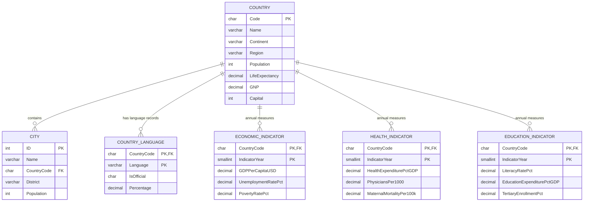

# Proposed ER diagram (logical)

This diagram reflects the intended schema after importing the original World database and running `sql/01_additional_tables.sql`. Verify against the actual MySQL schema before submission.

Note: The supplied base schema may not declare the City and CountryLanguage foreign keys in DDL. The lines above depict their conceptual relationship; added indicator-table FKs are declared by the extension script.
